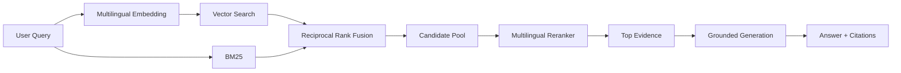
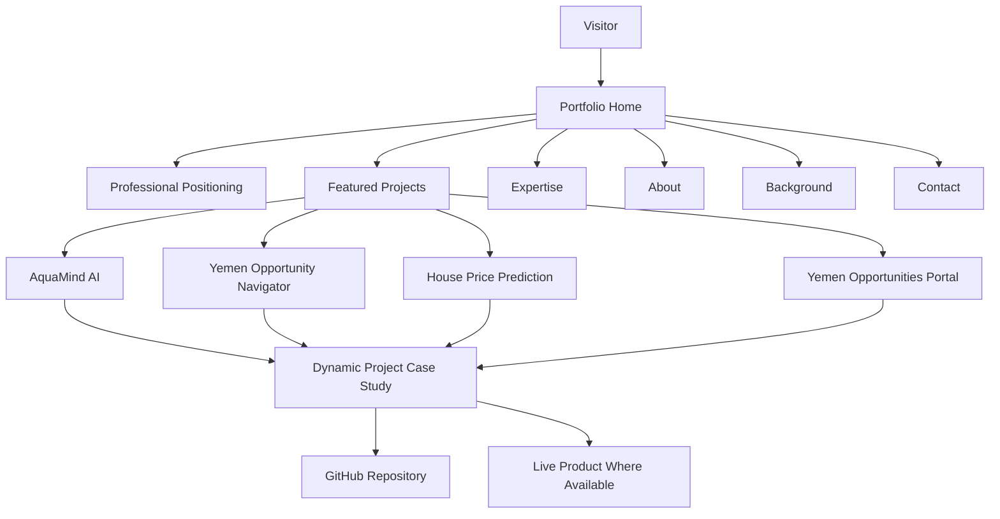

<div align="center">

# Mohammed Tariq — Portfolio

### AI Solutions Developer

**AI Agents · RAG Systems · MCP · Intelligent Automation · Machine Learning · Data Analytics**

A professional engineering portfolio showcasing production-oriented AI systems, autonomous agents, retrieval-augmented generation, machine learning, data analytics, and intelligent web applications.

[](https://nextjs.org/)
[](https://www.typescriptlang.org/)
[](https://tailwindcss.com/)
[](https://www.netlify.com/)
[](https://github.com/xmohamedtariq)

[GitHub](https://github.com/xmohamedtariq) ·
[LinkedIn](https://www.linkedin.com/in/mohammed-tariq-3a1a0824a/) ·
[Email](mailto:x.mohamedtariq@gmail.com)

</div>

---

## Overview

This repository contains the source code for my personal engineering portfolio.

The portfolio is designed to present more than a list of technologies. It documents real systems I have designed and built across several areas of artificial intelligence and software engineering, including:

- autonomous AI agents;
- Model Context Protocol integrations;
- retrieval-augmented generation;
- multilingual information retrieval;
- intelligent workflow automation;
- machine learning;
- predictive analytics;
- data-driven applications;
- bilingual web products;
- evaluation, safety, and deployment.

The portfolio is intentionally structured around **engineering evidence and project outcomes** rather than generic skill claims.

Each featured project demonstrates a different technical capability.

---

# Featured Engineering Work

## 01 — AquaMindAI-Agent

### Autonomous AI Agent for Reverse-Osmosis Operations

AquaMindAI-Agent is an autonomous engineering decision-support system designed to investigate operational degradation in reverse-osmosis desalination systems.

It combines a structured agent loop, Google Gemini reasoning, MCP-based engineering knowledge retrieval, persistent memory, safety constraints, permissions, auditability, and cost tracking.

### Core Capabilities

- autonomous Plan → Act → Observe → Reflect workflow;
- Google Gemini integration;
- Model Context Protocol;
- controlled operational tool calling;
- SQLite persistent incident memory;
- prompt-injection protection;
- human approval boundaries;
- cost and token tracking;
- JSONL execution traces;
- deterministic runtime safeguards;
- audit-integrity verification.

### Engineering Evidence

| Metric | Result |
|---|---:|
| Automated Tests | **572 / 572 Passed** |
| Source Coverage | **100%** |
| Agent Tool Calls in Successful Trace | **7** |
| Persistent Memory | **Verified** |
| MCP Runtime | **Verified** |
| Safety Enforcement | **Verified** |
| Cost Tracking | **Verified** |

**Stack**

`Python` · `Gemini` · `MCP` · `SQLite` · `Streamlit` · `Agentic AI` · `Tool Calling`

[View Repository →](https://github.com/xmohamedtariq/AquaMindAI-Agent)

[Open Live Application →](https://aquamindai-agent-mohammed-tariq1.vercel.app/)

---

## 02 — Yemen Opportunity Navigator

### Multilingual Retrieval-Augmented Generation System

Yemen Opportunity Navigator is an evidence-grounded multilingual RAG platform designed to help Yemeni users discover scholarships, internships, fellowships, grants, and other opportunities.

The system combines dense retrieval, lexical retrieval, reciprocal rank fusion, multilingual reranking, grounded answer generation, citations, authentication, favorites, and search history.

### Retrieval Architecture



### Evaluation Evidence

| Metric | Result |
|---|---:|
| Indexed Chunks | **5,802** |
| Golden Questions | **30** |
| Recall@5 | **100%** |
| RAGAS Average | **0.9526** |
| Context Precision | **1.000** |
| Context Recall | **1.000** |
| Faithfulness | **0.9875** |

### Retrieval Stack

`E5 Multilingual Embeddings` · `Chroma` · `BM25` · `Hybrid RRF` · `Cohere Reranking` · `RAGAS` · `Supabase` · `Streamlit`

[View Repository →](https://github.com/xmohamedtariq/Yemen_Opportunity_Navigator_RAG)

[Open Live Application →](https://yemen-opportunity-navigator.streamlit.app/)

---

## 03 — House Price Prediction — Aden City

### Machine Learning & Predictive Analytics

A localized machine-learning project for predicting residential property prices in Aden City using structured housing characteristics.

The project demonstrates the complete predictive analytics workflow:

```text
Raw Housing Data
        ↓
Data Validation
        ↓
Exploratory Data Analysis
        ↓
Feature Engineering
        ↓
Train / Test Split
        ↓
Regression Modeling
        ↓
Evaluation
        ↓
Prediction
```

### Dataset

Features include:

- property area;
- number of rooms;
- bathrooms;
- building age;
- district.

Target:

```text
property price
```

### Model Performance

| Metric | Result |
|---|---:|
| Dataset Size | **120 Properties** |
| Input Features | **5** |
| Training Records | **96** |
| Test Records | **24** |
| R² | **≈ 0.984** |
| MAE | **≈ 3,836.66** |
| RMSE | **≈ 4,416.94** |

The project is positioned as a localized predictive-analytics demonstration rather than a claim of production-grade real-estate valuation accuracy.

**Stack**

`Python` · `Pandas` · `NumPy` · `Scikit-learn` · `Regression` · `EDA` · `Predictive Analytics`

[View Repository →](https://github.com/xmohamedtariq/House-Price-Prediction-in-Aden-City)

> This project currently has no public live deployment.

---

## 04 — Yemen Opportunities Portal

### Bilingual Web Application & Progressive Web App

Yemen Opportunities Portal is a bilingual Arabic/English platform for discovering trusted educational and career opportunities relevant to Yemeni youth.

The application demonstrates frontend product development, responsive design, localization, offline functionality, and structured information presentation.

### Product Capabilities

- Arabic and English;
- RTL and LTR layouts;
- search and filtering;
- favorites;
- deadline tracking;
- opportunity detail pages;
- offline PWA support;
- responsive mobile interface;
- keyboard-friendly navigation;
- verified external source links.

### Product Evidence

| Metric | Result |
|---|---:|
| Curated Opportunities | **50** |
| Unique Sources | **43** |
| Mobile Target | **360px+** |
| Arabic / English | **Supported** |
| Offline PWA | **Supported** |

**Stack**

`HTML5` · `CSS3` · `JavaScript` · `PWA` · `Service Worker` · `LocalStorage` · `Responsive Design`

[View Repository →](https://github.com/xmohamedtariq/yemen-opportunities-portal)

[Open Live Website →](https://xmohamedtariq.github.io/yemen-opportunities-portal/)

---

# Portfolio Architecture

The portfolio itself is built as a lightweight modern web application using the Next.js App Router.



Project information is maintained as structured data and rendered into reusable project components and dynamic case-study routes.

This reduces duplicated presentation logic and makes future portfolio expansion easier.

---

# Portfolio Design Principles

## Engineering First

The portfolio focuses on:

- architecture;
- measured results;
- implementation decisions;
- technical scope;
- evidence;
- deployment;
- lessons learned.

It intentionally avoids generic statements that cannot be supported by actual work.

---

## Projects as Case Studies

Each featured project includes dedicated information covering:

- the problem;
- proposed solution;
- my role;
- architecture;
- key implementation highlights;
- results;
- challenges;
- lessons learned;
- technology stack.

This allows hiring teams to evaluate both the final product and the engineering reasoning behind it.

---

## Clear Technical Positioning

The portfolio is designed around my target role:

> **AI Solutions Developer**

with emphasis on the intersection of:

```text
AI Engineering
      +
Software Development
      +
Automation
      +
Data Analytics
      +
Applied Machine Learning
```

---

# Areas of Expertise

### AI Agents

Designing autonomous and semi-autonomous systems with explicit tools, permissions, memory, safety constraints, execution limits, audit trails, and human oversight.

### RAG Systems

Building grounded retrieval pipelines combining semantic search, lexical search, fusion, reranking, generation, citations, and evaluation.

### Model Context Protocol

Connecting agents with controlled external knowledge and tools through MCP-based architectures.

### Intelligent Automation

Designing AI-assisted workflows that reduce repetitive work while maintaining clear control boundaries.

### Machine Learning

Developing practical predictive pipelines covering preprocessing, exploratory analysis, feature engineering, modeling, and evaluation.

### Data Analytics

Transforming structured data into measurable insights, evaluation evidence, and decision-support outputs.

---

# Technology Stack

## AI & LLM Systems

- Google Gemini
- OpenAI
- Claude
- Cohere
- Hugging Face
- Model Context Protocol
- Tool Calling
- RAG
- Prompt Engineering
- Agentic Workflows
- LLM Evaluation
- Guardrails
- Human-in-the-Loop Systems

## Retrieval & Knowledge Systems

- E5 Multilingual Embeddings
- Chroma
- BM25
- Reciprocal Rank Fusion
- Cohere Reranking
- RAGAS

## Data & Machine Learning

- Python
- Pandas
- NumPy
- Scikit-learn
- Exploratory Data Analysis
- Regression
- Predictive Modeling

## Application Development

- Next.js
- TypeScript
- Tailwind CSS
- Streamlit
- JavaScript
- HTML
- CSS
- Progressive Web Apps

## Platforms & Infrastructure

- Git
- GitHub
- Netlify
- Vercel
- Streamlit Community Cloud
- Hugging Face Spaces
- Supabase
- SQLite

---

# Repository Structure

```text
Mohammed-Tariq-portfolio/
│
├── app/
│   ├── projects/
│   │   └── [slug]/
│   │       └── page.tsx
│   │
│   ├── globals.css
│   ├── layout.tsx
│   ├── not-found.tsx
│   └── page.tsx
│
├── components/
│   └── FeaturedProjects.tsx
│
├── data/
│   └── projects.ts
│
├── public/
│   └── Mohammed-Tariq-Resume.pdf
│
├── next.config.ts
├── package.json
├── tsconfig.json
└── README.md
```

---

# Local Development

## 1. Clone the Repository

```powershell
git clone https://github.com/xmohamedtariq/Mohammed-Tariq-portfolio.git
```

```powershell
cd Mohammed-Tariq-portfolio
```

---

## 2. Install Dependencies

```powershell
npm install
```

On Windows environments where PowerShell execution policy blocks `npm.ps1`, use:

```powershell
npm.cmd install
```

---

## 3. Start Development Server

```powershell
npm.cmd run dev
```

Then open:

```text
http://localhost:3000
```

---

## 4. Production Build

```powershell
npm.cmd run build
```

The current portfolio build includes static and partially prerendered routes for the main portfolio and individual project case studies.

---

# Project Routes

```text
/
```

Main portfolio.

```text
/projects/aquamind-ai
```

AquaMind AI case study.

```text
/projects/yemen-opportunity-navigator
```

Yemen Opportunity Navigator case study.

```text
/projects/house-price-prediction-aden
```

House Price Prediction case study.

```text
/projects/yemen-opportunities-portal
```

Yemen Opportunities Portal case study.

---

# Deployment

The portfolio is prepared for production deployment using **Netlify**.

Deployment responsibilities include:

- building the Next.js application;
- serving portfolio pages;
- serving project case-study routes;
- serving the public résumé;
- HTTPS delivery;
- production asset optimization.

The final production URL will be added to this README after deployment.

---

# Background

I am a **Mechatronics Engineering graduate** focused on building practical artificial-intelligence systems.

My work increasingly sits at the intersection of engineering and AI:

```text
Engineering Problem
        ↓
Structured Data / Knowledge
        ↓
AI Reasoning or Predictive Model
        ↓
Controlled Tools / Application Layer
        ↓
Measurable Output
        ↓
Human Decision or Automated Workflow
```

My primary focus is not simply using language models, but designing AI systems that are:

- useful;
- measurable;
- auditable;
- grounded;
- safe;
- maintainable.

---

# Education

**B.Sc. Mechatronics Engineering**

University of Science and Technology  
Aden, Yemen — 2026

---

# Certifications

Selected professional learning includes:

- Google Advanced Data Analytics Professional Certificate
- IBM AI Fundamentals
- Cisco Introduction to Modern AI
- Elements of AI — 2 ECTS
- Claude 101
- Gemini Certified Educator & Student

---

# Current Direction

I am particularly interested in opportunities involving:

- AI Solutions Development;
- AI Agent Development;
- Generative AI Applications;
- RAG Engineering;
- Intelligent Automation;
- Applied Machine Learning;
- Data Analytics;
- AI-enabled business workflows.

---

# Contact

**Mohammed Tariq**

AI Solutions Developer

📧 [x.mohamedtariq@gmail.com](mailto:x.mohamedtariq@gmail.com)

💼 [LinkedIn](https://www.linkedin.com/in/mohammed-tariq-3a1a0824a/)

💻 [GitHub](https://github.com/xmohamedtariq)

📍 Aden, Yemen

---

<div align="center">

### Building AI systems that move from demos to useful engineering solutions.

**AI Agents · RAG · MCP · Automation · Machine Learning · Data Analytics**

</div>
