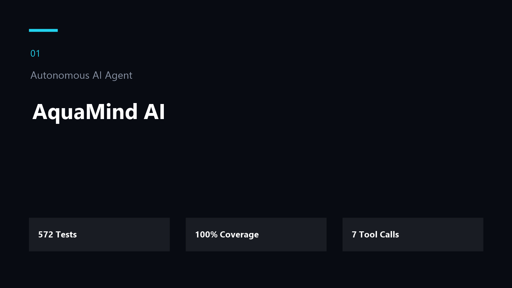
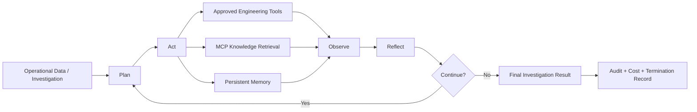
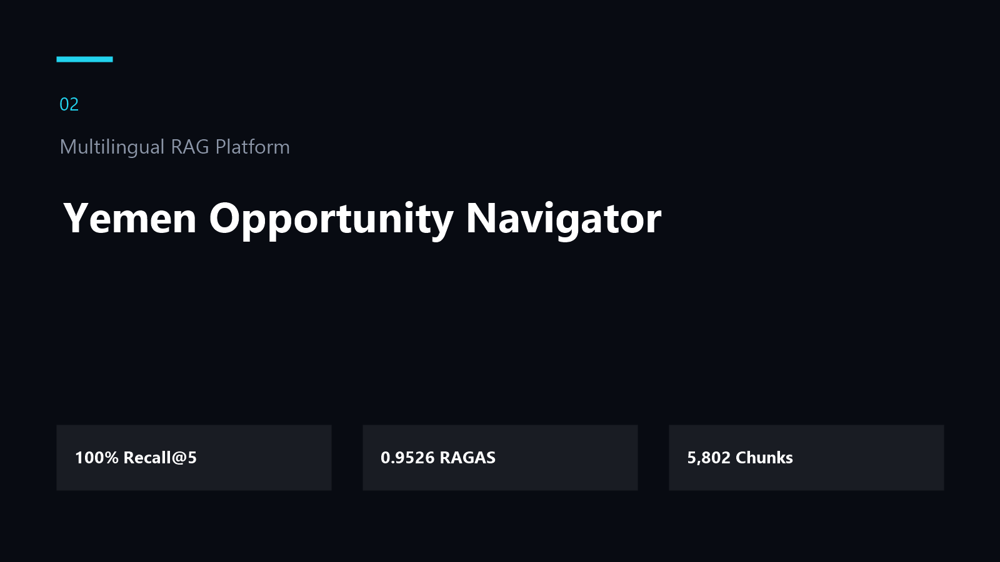
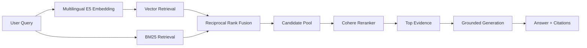
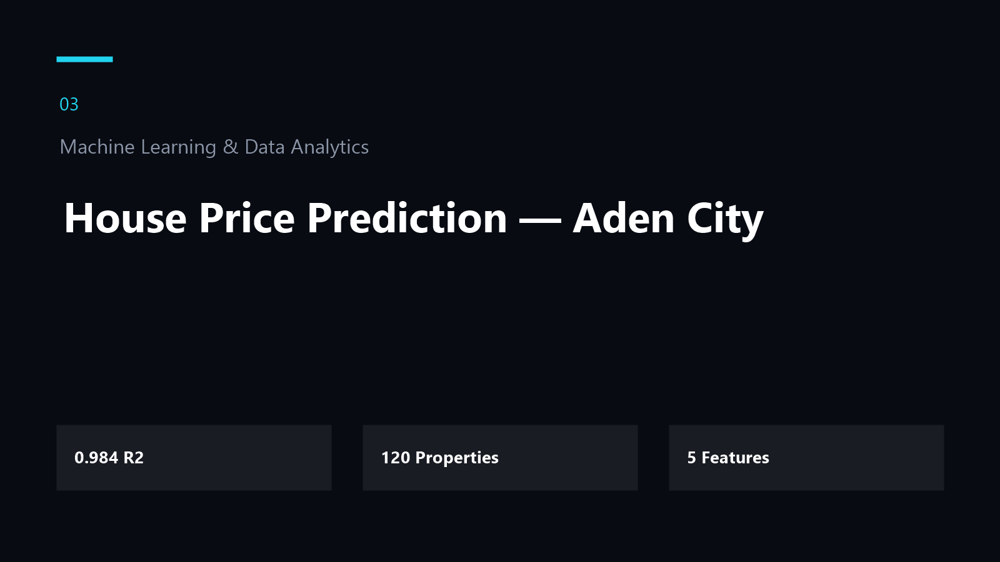
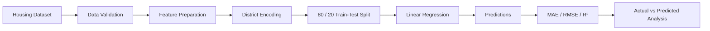
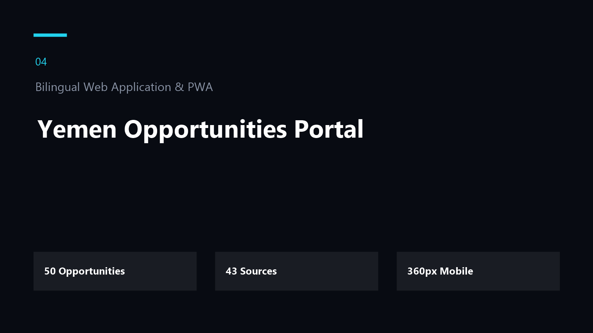
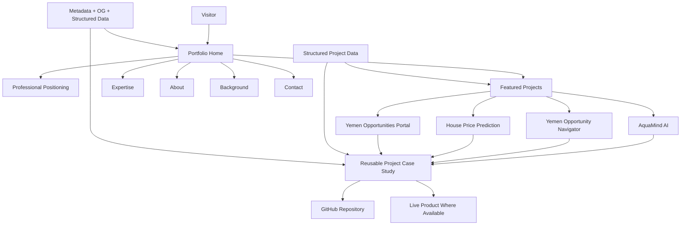

<div align="center">


# Mohammed Tariq

### AI Solutions Developer

**AI Agents · RAG Systems · MCP · Intelligent Automation · Machine Learning · Data Analytics**

Building intelligent AI systems that combine reasoning, retrieval, tools, memory, evaluation, safety, and measurable engineering outcomes.

<br />

[](https://mohammed-tariq-portfolio.netlify.app/)
[](https://github.com/xmohamedtariq)
[](https://www.linkedin.com/in/mohammed-tariq-3a1a0824a/)
[](mailto:x.mohamedtariq@gmail.com)

<br />

[](https://nextjs.org/)
[](https://www.typescriptlang.org/)
[](https://tailwindcss.com/)
[](https://www.netlify.com/)
[](#quality--engineering-standards)

</div>

---

## Overview

This repository contains my personal engineering portfolio, built to present **real AI systems and measurable technical work** rather than a generic list of tools or technologies.

The portfolio focuses on systems I have designed and implemented across:

- autonomous AI agents;
- Model Context Protocol integrations;
- retrieval-augmented generation;
- hybrid information retrieval;
- intelligent automation;
- machine learning;
- predictive analytics;
- data-driven applications;
- AI evaluation and reliability;
- safety and human approval;
- bilingual web applications;
- modern frontend engineering;
- production deployment.

The core idea behind this portfolio is simple:

> **Show the engineering evidence behind the work.**

Each featured project is presented as a structured case study covering the problem, architecture, implementation, results, challenges, lessons learned, repository, and live product where available.

---

# Featured Engineering Work

## 01 — AquaMind AI

### Autonomous AI Agent for Reverse-Osmosis Operations

<p align="center">
  
</p>

AquaMind AI is an autonomous engineering decision-support agent designed to investigate operational degradation in reverse-osmosis desalination systems.

The system combines LLM reasoning with deterministic operational controls, engineering tools, Model Context Protocol knowledge retrieval, persistent memory, permission boundaries, auditability, and task-level cost tracking.

### Engineering Highlights

- Plan–Act–Reflect autonomous agent loop
- Google Gemini integration
- Model Context Protocol knowledge retrieval
- persistent SQLite memory
- human-in-the-loop permission tiers
- controlled operational tool execution
- task-level token and cost tracking
- hash-chained audit logging
- prompt-injection protection
- deterministic termination conditions
- reproducible success and failure traces
- public deployment

### Verified Evidence

| Metric | Result |
|---|---:|
| Automated Tests | **572 / 572 Passed** |
| Test Coverage | **100%** |
| Successful Agent Trace | **7 Turns / 7 Tool Calls** |
| Persistent Memory | **Verified Across Restart** |
| MCP Client / Server | **Verified** |
| Cost Tracking | **Verified** |
| Audit Integrity | **Verified** |
| Safety Enforcement | **Verified** |

### Architecture



**Stack**

`Python` · `Gemini` · `MCP` · `SQLite` · `Streamlit` · `Tool Calling` · `Agentic AI` · `Human-in-the-Loop`

**Links**

[View Repository →](https://github.com/xmohamedtariq/AquaMindAI-Agent)

[Open Live Application →](https://aquamindai-agent-mohammed-tariq1.vercel.app/)

---

## 02 — Yemen Opportunity Navigator

### Multilingual Retrieval-Augmented Generation Platform

<p align="center">
  
</p>

Yemen Opportunity Navigator is a bilingual RAG platform designed to help Yemeni students and professionals discover scholarships, internships, fellowships, grants, and other opportunities from distributed sources.

The system combines dense semantic retrieval, lexical retrieval, Reciprocal Rank Fusion, multilingual reranking, grounded answer generation, citations, authentication, favorites, and search history.

### Retrieval Architecture



### Evaluation Evidence

| Metric | Result |
|---|---:|
| Indexed Knowledge Chunks | **5,802** |
| Golden Questions | **30** |
| Recall@5 | **100%** |
| RAGAS Average | **0.9526** |
| Faithfulness | **0.9875** |
| Context Precision | **1.000** |
| Context Recall | **1.000** |

### Core Capabilities

- Arabic and English retrieval
- multilingual embeddings
- Chroma vector database
- BM25 lexical retrieval
- hybrid Reciprocal Rank Fusion
- multilingual reranking
- evidence-backed answers
- source citations
- authentication
- favorites
- search history
- public Streamlit deployment

**Stack**

`E5 Multilingual` · `Chroma` · `BM25` · `Hybrid RRF` · `Cohere` · `RAGAS` · `Supabase` · `Streamlit`

**Links**

[View Repository →](https://github.com/xmohamedtariq/Yemen_Opportunity_Navigator_RAG)

[Open Live Application →](https://yemen-opportunity-navigator.streamlit.app/)

---

## 03 — House Price Prediction — Aden City

### Machine Learning & Predictive Analytics

<p align="center">
  
</p>

A localized supervised machine-learning project for predicting residential property prices in Aden City using structured housing characteristics.

The project demonstrates a complete predictive analytics workflow from data preparation through model training, evaluation, and interpretation.

### Machine Learning Workflow



### Model Evidence

| Metric | Result |
|---|---:|
| Dataset Size | **120 Properties** |
| Input Features | **5** |
| Training Records | **96** |
| Test Records | **24** |
| R² | **≈ 0.984** |
| MAE | **≈ 3,836.66** |
| RMSE | **≈ 4,416.94** |

### Predictive Features

- property area;
- number of rooms;
- bathrooms;
- building age;
- district.

The project is intentionally presented as a localized predictive analytics demonstration rather than a claim of production-grade real-estate valuation accuracy.

**Stack**

`Python` · `Pandas` · `NumPy` · `Scikit-learn` · `Regression` · `EDA` · `Predictive Analytics`

**Link**

[View Repository →](https://github.com/xmohamedtariq/House-Price-Prediction-in-Aden-City)

> No public live deployment is currently provided for this project.

---

## 04 — Yemen Opportunities Portal

### Bilingual Web Application & Progressive Web App

<p align="center">
  
</p>

Yemen Opportunities Portal is a bilingual Arabic/English platform for discovering educational and career opportunities relevant to Yemeni youth.

The application demonstrates frontend engineering, localization, responsive design, offline capability, structured information presentation, and Progressive Web App development.

### Product Capabilities

- Arabic and English
- RTL and LTR interfaces
- search and filtering
- favorites
- deadline information
- responsive mobile experience
- offline PWA capability
- keyboard-friendly navigation
- safe DOM implementation
- verified external source links
- GitHub Pages deployment

### Product Evidence

| Metric | Result |
|---|---:|
| Opportunities | **50** |
| Unique Sources | **43** |
| Mobile Target | **360px+** |
| Arabic / English | **Supported** |
| Offline PWA | **Supported** |

**Stack**

`HTML5` · `CSS3` · `JavaScript` · `PWA` · `Service Worker` · `LocalStorage` · `RTL` · `Responsive Design`

**Links**

[View Repository →](https://github.com/xmohamedtariq/yemen-opportunities-portal)

[Open Live Website →](https://xmohamedtariq.github.io/yemen-opportunities-portal/)

---

# Portfolio Experience

The portfolio itself is designed as an engineering product.

It includes:

- premium dark-mode interface;
- responsive layout;
- dedicated project case studies;
- project imagery;
- reusable structured project data;
- accessible keyboard focus states;
- reduced-motion support;
- custom `MT` identity;
- downloadable resume;
- direct GitHub and LinkedIn access;
- production SEO metadata;
- Open Graph sharing image;
- individual project metadata;
- canonical URLs;
- structured Person data;
- sitemap;
- robots configuration;
- web manifest;
- custom favicon;
- static export;
- Netlify deployment.

---

# Portfolio Architecture



Project information is stored as structured TypeScript data and rendered through reusable components and dynamic project routes.

This keeps the portfolio maintainable and allows additional projects to be added without duplicating page architecture.

---

# Case Study Structure

Each featured project has its own dedicated route:

```text
/projects/aquamind-ai/
/projects/yemen-opportunity-navigator/
/projects/house-price-prediction-aden/
/projects/yemen-opportunities-portal/
```

Each case study presents:

1. project context;
2. problem;
3. solution;
4. my role;
5. architecture;
6. key implementation highlights;
7. measurable results;
8. technical challenges;
9. lessons learned;
10. technology stack;
11. repository and live application links.

---

# Engineering Philosophy

## Build Systems, Not Demos

My work focuses on combining model intelligence with the engineering components necessary for reliable applications:

```text
Reasoning
   +
Knowledge
   +
Tools
   +
Memory
   +
Permissions
   +
Evaluation
   +
Observability
   +
Deployment
```

A useful AI system is not defined only by the model it uses.

Reliability also depends on:

- architecture;
- retrieval quality;
- deterministic safeguards;
- permissions;
- failure handling;
- evaluation;
- cost controls;
- observability;
- human oversight.

---

## Evidence Over Claims

This portfolio intentionally prioritizes measurable evidence such as:

- automated test counts;
- coverage;
- retrieval metrics;
- evaluation scores;
- execution traces;
- source citations;
- architecture;
- live deployments;
- reproducible results.

The goal is to make technical capability **demonstrable rather than implied**.

---

# Areas of Expertise

<table>
<tr>
<td width="33%" valign="top">

### AI Agents

- tool calling
- Plan–Act–Reflect loops
- memory
- permissions
- human approval
- safety controls
- auditability

</td>
<td width="33%" valign="top">

### RAG Systems

- semantic retrieval
- BM25
- hybrid search
- reranking
- citations
- evaluation
- multilingual RAG

</td>
<td width="33%" valign="top">

### Intelligent Automation

- workflow automation
- tool orchestration
- business processes
- API integration
- decision support
- controlled execution

</td>
</tr>

<tr>
<td width="33%" valign="top">

### Machine Learning

- supervised learning
- regression
- preprocessing
- evaluation
- predictive modeling
- scikit-learn

</td>
<td width="33%" valign="top">

### Data Analytics

- data exploration
- visualization
- reporting
- statistical analysis
- decision support

</td>
<td width="33%" valign="top">

### AI Applications

- architecture
- implementation
- testing
- deployment
- UX
- reliability

</td>
</tr>
</table>

---

# Technology Stack

### Artificial Intelligence

`AI Agents`  
`RAG`  
`MCP`  
`Tool Calling`  
`Prompt Engineering`  
`Human-in-the-Loop`  
`LLM Evaluation`  
`Guardrails`  
`Persistent Memory`

### Models & AI Platforms

`Google Gemini`  
`OpenAI`  
`Claude`  
`Cohere`  
`Hugging Face`

### Retrieval & Search

`E5 Multilingual Embeddings`  
`Chroma`  
`BM25`  
`Hybrid RRF`  
`Reranking`

### Programming & Data

`Python`  
`TypeScript`  
`JavaScript`  
`Pandas`  
`NumPy`  
`Scikit-learn`

### Frontend

`Next.js`  
`React`  
`Tailwind CSS`  
`HTML5`  
`CSS3`

### Data & Storage

`SQLite`  
`Supabase`

### Deployment & Engineering

`Git`  
`GitHub`  
`Netlify`  
`Vercel`  
`GitHub Pages`  
`Streamlit`  
`Hugging Face Spaces`

---

# SEO & Discoverability

The portfolio includes a complete search and social-sharing foundation.

### Implemented

- metadata title templates;
- production `metadataBase`;
- canonical URLs;
- Open Graph metadata;
- Twitter / social preview metadata;
- project-specific metadata;
- custom Open Graph image;
- `robots.txt`;
- `sitemap.xml`;
- JSON-LD Person structured data;
- web manifest;
- custom application icon;
- semantic HTML structure.

Production URL:

**https://mohammed-tariq-portfolio.netlify.app**

---

# Quality & Engineering Standards

The portfolio is built as a lightweight static production site.

### Latest Verified Lighthouse

| Category | Score |
|---|---:|
| Performance | **100** |
| Accessibility | **95** |
| Best Practices | **100** |
| SEO | **100** |

Accessibility contrast polishing is being used to target full compliance across low-contrast secondary text.

### Performance Evidence

| Metric | Result |
|---|---:|
| First Contentful Paint | **0.8 s** |
| Largest Contentful Paint | **0.8 s** |
| Speed Index | **0.8 s** |
| Total Blocking Time | **20 ms** |
| Cumulative Layout Shift | **0** |

### Production Dependency Audit

```text
npm audit --omit=dev
found 0 vulnerabilities
```

---

# Accessibility

Accessibility is treated as part of the implementation rather than an afterthought.

Implemented considerations include:

- visible keyboard focus states;
- semantic document structure;
- descriptive link text;
- image alternative text;
- reduced-motion support;
- mobile touch targets;
- valid page language;
- responsive navigation;
- accessible headings;
- keyboard-focusable controls;
- contrast optimization.

---

# Responsive Design

The interface is designed for:

- desktop;
- laptop;
- tablet;
- mobile;
- narrow mobile screens.

Key responsive behaviors include:

- adaptive typography;
- flexible project grids;
- responsive metric layouts;
- mobile navigation;
- wrapping action buttons;
- responsive project visuals;
- optimized content widths.

---

# Project Structure

```text
mohammed-tariq-portfolio/
│
├── app/
│   ├── projects/
│   │   └── [slug]/
│   │       └── page.tsx
│   │
│   ├── globals.css
│   ├── icon.svg
│   ├── layout.tsx
│   ├── not-found.tsx
│   └── page.tsx
│
├── components/
│   └── FeaturedProjects.tsx
│
├── data/
│   └── projects.ts
│
├── public/
│   ├── projects/
│   │   ├── aquamind-ai.png
│   │   ├── yemen-opportunity-navigator.png
│   │   ├── house-price-prediction-aden.png
│   │   └── yemen-opportunities-portal.png
│   │
│   ├── Mohammed-Tariq-Resume.pdf
│   ├── mt-icon.svg
│   ├── og-image.png
│   ├── robots.txt
│   ├── site.webmanifest
│   └── sitemap.xml
│
├── next.config.ts
├── netlify.toml
├── package.json
├── tsconfig.json
└── README.md
```

---

# Local Development

## Requirements

- Node.js
- npm

Clone the repository:

```bash
git clone https://github.com/xmohamedtariq/Mohammed-Tariq-portfolio.git
```

Enter the project:

```bash
cd Mohammed-Tariq-portfolio
```

Install dependencies:

```bash
npm install
```

Run the development server:

```bash
npm run dev
```

Open:

```text
http://localhost:3000
```

---

# Production Build

Create the optimized static production build:

```bash
npm run build
```

The portfolio uses:

```ts
output: "export"
```

Next.js generates the static site inside:

```text
out/
```

To test the static production output locally:

```bash
npx serve out
```

---

# Deployment

The portfolio is deployed on **Netlify**.

Build configuration:

```toml
[build]
  command = "npm run build"
  publish = "out"

[build.environment]
  NETLIFY_NEXT_PLUGIN_SKIP = "true"
```

Production:

### [mohammed-tariq-portfolio.netlify.app](https://mohammed-tariq-portfolio.netlify.app/)

The site is automatically redeployed when updates are pushed to the `main` branch.

---

# Background

I come from a **Mechatronics Engineering** background and apply engineering thinking to modern AI systems.

My work increasingly focuses on the intersection of:

```text
Engineering
     ×
Artificial Intelligence
     ×
Automation
     ×
Data
```

This combination influences how I approach AI development: not as isolated model usage, but as the design of complete technical systems.

---

# Education

### B.Sc. in Mechatronics Engineering

**University of Science and Technology — Aden**

2026

---

# Selected Certifications

- Google Advanced Data Analytics Professional
- IBM AI Fundamentals
- Cisco Introduction to Modern AI
- Elements of AI — 2 ECTS
- Claude 101
- Gemini Certified Educator
- Gemini Certified Student

---

# Current Direction

I am focused on building and improving systems involving:

- autonomous AI agents;
- agent reliability;
- Model Context Protocol;
- retrieval-augmented generation;
- AI workflow automation;
- LLM evaluation;
- human-in-the-loop systems;
- intelligent decision-support systems;
- production AI applications.

A major current focus is the continued evolution of **AquaMind AI** from an autonomous engineering investigation agent toward a broader predictive and operational intelligence platform.

---

# What I Look For

I am particularly interested in opportunities involving:

- AI Solutions Development
- AI Agent Development
- Applied AI Engineering
- RAG Engineering
- Intelligent Automation
- Generative AI Applications
- Machine Learning
- Data Analytics

I am open to **remote opportunities** and engineering roles where AI is used to solve real operational or business problems.

---

# Contact

<div align="center">

### Let's build intelligent systems.

[](mailto:x.mohamedtariq@gmail.com)

[](https://www.linkedin.com/in/mohammed-tariq-3a1a0824a/)

[](https://github.com/xmohamedtariq)

[](https://mohammed-tariq-portfolio.netlify.app/)

<br />

**Aden, Yemen · Open to Remote Opportunities**

</div>

---

<div align="center">

Built with **Next.js · TypeScript · Tailwind CSS**

Designed and developed by **Mohammed Tariq**

</div>
